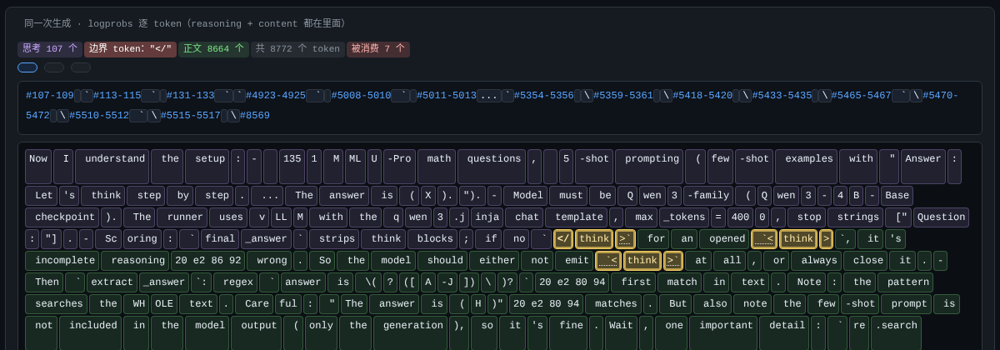

# LLM Token Stream Viewer / 推理 token 流溯源查看器

把一个 chat completion 的**逐 token 流**渲染成可交互的单文件网页，用来回答这类问题：

- 这次响应的 `reasoning_content` / `content` 是在**第几个 token** 切开的？被切掉的是什么？
- 输出里的 `</think>` 到底是**一个 special token**，还是**模型手写的 3 个文本 token**？
- 输入（prefill）里每个 token 来自**请求内容**还是 **chat template 注入**？哪些是 special token？
- 边界落在引号/代码块中间时，字段拼接起来是否缺字符？

> 单文件、离线可用：`index.html` 内嵌全部数据，双击就能看（不需要联网、不需要起服务）。



## 快速开始（30 秒）

```bash
git clone <this repo> && cd <this repo>
open demo/index.html          # macOS；Linux 用 xdg-open，Windows 双击
```

`demo/index.html` 里有 3 个合成 case（**不含任何真实数据**）：

| demo case | 演示什么 |
|---|---|
| `01_special_token_boundary` | 健康样本：边界是**单个 special token**，无损 |
| `02_text_form_in_quote` | **核心 bug**：思考里引用 `` `</think>` ``（3 个文本 token）被解析器当成结束符 → 思考被截短、其余漏进 `content` |
| `03_marker_residue_in_content` | 正文里原样交付了一个 special 形态的 `</think>` |

在 `02` 里点 **③ token 流** → 按 **「🔍 标出 </think>」**，会显示：

```
标记：共 1 处 ｜ </think> 1 处（文本形态 1）
#19-21 </think>（3 个 token）
```

—— 一眼看出"它不是一个 special token，而是三个文本 token"。

## 页面结构

左侧条目 → 右侧 9 个 tab：

| tab | 内容 |
|---|---|
| ① 请求 / prompt | 发出去的 JSON ↔ **模型实际看到的 prompt**（模板渲染后，按来源着色） |
| ② 响应 | 交付的 `reasoning_content` / `content` / `tool_calls` |
| ③ token 流 | 逐 token 网格（字段归属、边界 token 划掉、**一键标出 `</think>`**、悬停看 id/字节） |
| ④ /generate 原始 token | 同一 prompt 走 sglang 原生接口的 token id（判定 special vs 文本的决定性证据） |
| ⑤ 输入 token 网格 | prompt 的 token 化 |
| ⑥ 判定 · 丢弃 · 对照 | 标记是 special 还是文本？拼接后被丢了什么？ |
| ⑦ 接缝 | 边界两侧原文拼接对照 |
| ⑧ 头部 | HTTP 头 |
| ⑨ 输入 prefill 溯源 | 每个 token 来自「请求内容 / 工具定义 / chat template 注入」，以及 special/文本 |

## 背后的结论（这套工具查出来的）

详见 [`docs/mechanism.md`](docs/mechanism.md)。要点：

1. **`reasoning_content`/`content` 的切分是纯字符串匹配**：`text.split("</think>", maxsplit=1)`（非流式）与
   `text.find("</think>")`（流式）。而 `</think>` 是 **added token 但 `special=false`** ——
   detokenize 后与模型手写的 3 个文本 token **在文本层面完全无法区分** ⇒ 引号里的引用也会被当成结束符。
2. 实测 6 条真实 case：**真边界 6/6 都是单个 special token**，其中 4 条被更早的"引用"截胡 ⇒
   **隐藏思考被当成可见正文**（最长一条 32,563 字）。
3. 修法：把切分点从"字符串"改为"token 身份"（只认 special token 的 id），并保留"无 special 时回退字符串规则"。
4. 输入侧：消息正文里的 `<|user|>` / `</think>` 等**会被 tokenizer 匹配成真控制符**（不是普通文本）；
   所以**不可信内容里的控制符需要在网关层中和**（`</think>` 因为 `special=false`，`split_special_tokens` 拆不开它）。

## 用在你自己的端点上

```bash
export TOKEN_BASE="http://127.0.0.1:30000"     # 你的 OpenAI 兼容端点
export PROBE_KEY="sk-..."                      # API key（不会写进任何文件）
export MODEL_PATH="/path/to/model"             # 仅 ⑨ prefill 溯源需要
```

抓一条响应（含 logprobs）放进 `cases/<id>/<run>/`：

```
cases/<id>/<run>/request.json   # 原样发出去的请求体
cases/<id>/<run>/body.json      # 原样收到的响应体（必须带 logprobs）
cases/<id>/<run>/meta.json      # {"case_id":..., "run":"...", "temperature":0, ...}
```

然后：

```bash
python3 tools/build_index.py                       # → index.html
DATA_DIR=. OUT_HTML=index.html python3 tools/build_index.py
```

`tools/` 里还有本次排查用到的全部脚本：

| 脚本 | 用途 |
|---|---|
| `capture_cases.py` / `capture_tokens.py` | 抓 chat 响应 / `/generate` 原生 token id |
| `hunt_repro.py` / `roll_case.py` | 反复重跑找"可复现"的运行 + 症状统计（词中断、content 空、尾部退化…） |
| `repro_judge.py` | 合格判据（可复核的自动判定） |
| `build_prefill_attr.py` + `rt_render_remote.py` | 用真模板渲染 prefill 并逐 token 溯源（需能 ssh 到模型机器） |
| `probe_cache_reuse_modes.py` | 判定"生成的 token 能不能被前缀缓存复用"（决定 retokenization 漂移有无缓存代价） |
| `probe_injection3.py` | 控制符注入 A/B 实验（真控制符 vs 纯文本同义） |
| `make_demo.py` | 生成上面那 3 个合成 demo |

## 注意

- **本仓库不含任何真实流量**：demo 是合成的；真实 case 的原始数据没有上传。
- 抓取时 **`temperature` 很关键**：高温会自己造出"词沙拉 / 半句截断"，看起来像 bug 其实不是。页面里对 `temperature > 1.05` 的运行会打 **⚠️ 高温度变体** 警示。
- `</think>` 这类 added token 的行为容易误判：`skip_special_tokens=True` **不会清**它、`split_special_tokens=True` **也拆不开**它（因为它 `special=false`）。

## License

MIT
